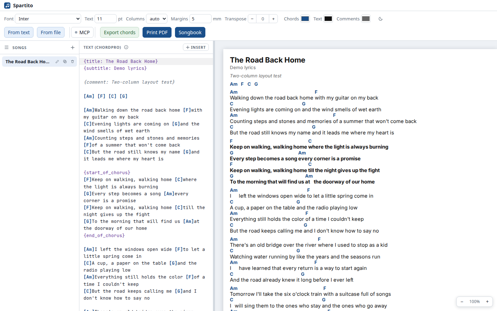

# Spartito

[](https://github.com/fedetamburlin/spartito/actions/workflows/deploy.yml)

**Turn ChordPro lyrics and chords into clean, one-page A4 PDFs made for reading on a tablet.** Write or paste a song, tune the layout, print it once, and keep the PDF. Spartito runs entirely in the browser: no account, no backend, no upload.

[Live app](https://fedetamburlin.github.io/spartito/) · [Changelog](CHANGELOG.md) · [Architecture](ARCHITECTURE.md) · [Contributing](CONTRIBUTING.md)



## Features

- **One page per song.** Automatic 1→2 column layout and font fitting down to 6 pt lyrics / 5 pt chords. The size you choose is never increased automatically.
- **ChordPro editor.** Chords, directives and comments are highlighted; search with Ctrl/Cmd+F, undo/redo, insert snippets and a built-in syntax reference.
- **Song library.** Keep many songs in IndexedDB, one active at a time. Rename, duplicate and delete from the sidebar.
- **Backups.** Export the whole library as a versioned JSON file and restore it with merge or replace. The app asks the browser for persistent storage and says when storage is best effort.
- **Import.** Paste text from Ultimate Guitar or another chord site, or open `.cho`, `.crd`, `.json` and text-based PDFs.
- **Transpose and capo.** Transpose the preview and PDF without changing the source; `{capo: N}` moves with it.
- **Print-ready output.** Print one song or build a songbook with selected songs in a custom order, one song per sheet.
- **Local-first.** Songs and settings stay in your browser. The PDF is the portable artifact: export once, read anywhere.
- **Dark UI, white paper.** The app chrome follows the system theme; the A4 sheet stays print-white.

## Your data and backups

Songs live in IndexedDB in this browser. On load, Spartito checks whether the
browser already guarantees persistent storage; after the first edit it asks for
it. If the browser declines, the sidebar shows **Storage: best effort** and you
should keep a backup.

**Backup** (sidebar) downloads a versioned JSON file with every song, its
layout settings and the active song. **Restore** can:

- **Merge** — keep the current library and add only songs that are missing.
- **Replace** — delete the current library first, then restore the backup.

The backup format is versioned and will stay readable across 1.x releases.
Backups do not include the theme or other browser preferences.

## Quick start

Use the [live app](https://fedetamburlin.github.io/spartito/) or run it locally:

```bash
npm ci
npm run dev
```

Requires **Node.js 22.12+** (Node 24+ is also supported; `.nvmrc` pins 22).

Production build:

```bash
npm run build
npm run preview
```

## Making a PDF

1. Write or paste a ChordPro song in the editor.
2. Adjust text size, columns, margins and transposition; the preview updates live.
3. Click **Print PDF** and choose **Save as PDF** in Chrome/Chromium. Keep the default margins and turn headers off.

Spartito keeps the song on one A4 page. If even the minimum size does not fit, it warns you before printing. Chrome/Chromium is the reference renderer.

## Browser support and limitations

- Current Chrome, Edge, Firefox and Safari. PDF export is tuned for Chrome/Chromium.
- One A4 page per song; songs that overflow are listed before printing. The songbook cover is measured too: if the title list cannot fit, Spartito warns before export.
- Songs live in this browser only: no account, sync or server backup. Export a JSON backup from the sidebar and keep the PDFs you care about.

## MCP automation (optional)

`packages/mcp` is a local MCP server that lets a client such as opencode read or edit the open song, change layout settings and export a PDF. It connects to the app through a localhost WebSocket bridge; song data is not sent to a server.

See [`docs/mcp.md`](docs/mcp.md) for setup, tools and troubleshooting.

## Development

```bash
npm ci
npx playwright install chromium
npm run verify
```

`npm run verify` runs formatting, lint, type checking, unit tests, browser E2E, MCP checks and the MCP build.

| Command                     | Purpose                           |
| --------------------------- | --------------------------------- |
| `npm run dev`               | Vite dev server                   |
| `npm run build` / `preview` | production build / serve it       |
| `npm run check`             | Svelte + TypeScript diagnostics   |
| `npm test`                  | unit and integration tests        |
| `npm run test:e2e`          | build + Playwright Chromium suite |
| `npm run verify`            | full pre-PR gate                  |

Project structure, test layers and conventions are in [`CONTRIBUTING.md`](CONTRIBUTING.md), [`ARCHITECTURE.md`](ARCHITECTURE.md) and [`tests/README.md`](tests/README.md). Maintainers can find the release and dependency policy in [`MAINTAINING.md`](MAINTAINING.md).

## Status

Spartito is actively maintained. Current release: **v1.0.0**. Scope: one-page A4 sheets, song library with full JSON backups, text/PDF import, songbook export and local MCP automation. Planned work includes additional page formats, installable PWA, Italian UI, setlists and notation.

## Feedback

Found a bug or missing a feature? [Open an issue](https://github.com/fedetamburlin/spartito/issues/new/choose). Include your browser, device and, when relevant, the ChordPro source.

Participation follows the [Code of Conduct](CODE_OF_CONDUCT.md). Report security issues privately as described in [SECURITY.md](SECURITY.md).

## License

MIT. Bundled fonts are under the SIL Open Font License 1.1 (see `public/fonts/OFL-*.txt`).
